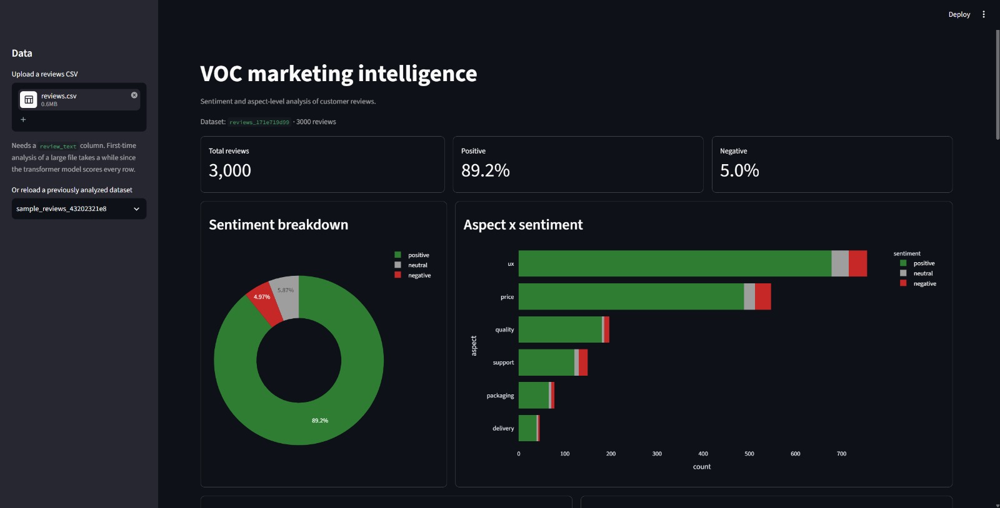

# VoC Marketing Intelligence

**An end-to-end Voice-of-Customer analytics system that turns raw customer reviews into sentiment, aspect-level insight, and AI-generated marketing strategy.**

Upload a CSV of customer reviews and get back a full marketing-intelligence readout: how customers feel, *what* they're talking about, the themes no one pre-defined, and a prioritized set of marketing recommendations written by an LLM and grounded strictly in the computed data.



---

## Why it exists

Businesses sit on tens of thousands of reviews and read almost none of them. Star ratings hide *why* customers feel the way they do, and even when a team finds a signal, turning it into action is a separate manual job. This system closes that loop — from raw reviews to a strategy a marketer can act on.

## What it does

- **Sentiment** — positive / neutral / negative on every review via a transformer model (`cardiffnlp/twitter-roberta-base-sentiment-latest`), benchmarked against a VADER lexicon baseline.
- **Aspect mining** — tags what customers discuss (delivery, price, quality, support, packaging, UX) and crosses it with sentiment to surface top complaints and top praise. Each mention's sentiment is scored on its **own sentence** (RoBERTa, with negation handling for "not easy" / "no value") instead of inheriting the whole review's (`ASPECT_SENTIMENT_MODE` in `config.py`; `"review"` restores the old behaviour; clause splitting at "but"/"however" is on by default). On a draft-labelled audit sample this raised UX-mention precision from 75% to 84% - see [docs/aspect_eval.md](docs/aspect_eval.md) for the numbers and limits.
- **Topic discovery** — BERTopic surfaces themes no one hard-coded, exposing what a fixed lexicon misses. Run it from the dashboard's *Discovered Topics* tab (on demand, cached in SQLite per dataset): top topics by size, per-topic sentiment split and example reviews, and a coverage comparison of the 6-aspect lexicon vs discovered topics.
- **Interactive dashboard** — Streamlit app with sentiment breakdowns, aspect×sentiment charts, word clouds, a sentiment-over-time view, and a filterable review table. Top complaints are ranked by **impact** (negative mentions, not negative share), with aspects under 30 mentions flagged low-confidence; aspects whose counts are within counting noise are flagged **statistically close** (the dashboard and the strategy won't claim a clear #1 that isn't one); after every analysis the dashboard warns if the results look like a mis-mapped column (mostly neutral, almost no aspects, tiny text, unparseable dates); the time view is weekly (% negative and net sentiment).
- **AI strategy layer** — an LLM (Google Gemini) reads the computed aggregates (including the most negative-heavy discovered topics) and writes an executive summary plus prioritized, **grounded** recommendations — every claim tied to a real number, no fabrication. The response is schema-validated (pydantic, one corrective retry), every figure in it is checked against the data sent to the model, the panel shows which model answered (set `GEMINI_MODEL`; a 429/503 retries once on `gemini-flash-lite-latest`), and a cached strategy is flagged out of date when the underlying data changes.

## Key results

Validated on the [Datafiniti Amazon Consumer Reviews](https://www.kaggle.com/datasets/datafiniti/consumer-reviews-of-amazon-products) dataset (34,659 cleaned reviews; 3,000-row analysis sample).

| Metric | VADER (lexicon) | Transformer (RoBERTa) |
|---|---|---|
| Macro-F1 | 0.42 | **0.51** |
| Negative-class recall | 0.36 | **0.74** |

The dataset is ~94% positive, so headline accuracy is inflated for both models — the honest metrics are **macro-F1** and **negative-class recall**, where the transformer catches roughly **twice as many dissatisfied customers**.

**Headline finding:** the six hand-built aspects were tuned for delivery/service language; on real electronics reviews, BERTopic discovered **31 themes** (battery life, screen/glare, apps, setup, streaming, Alexa…) the lexicon never captured — direct evidence that keyword lexicons don't transfer across domains, and that unsupervised topic modeling is what reveals the gap.

## Architecture

```
Ingest -> Clean -> Sentiment -> Aspects -> Persist -> Strategize
 CSV      dual-    VADER +      keyword    SQLite     Gemini
 load     track    RoBERTa      + BERTopic  cache     (grounded)
```

The cleaning stage is **dual-track**: a *light* clean (URLs/HTML only, case and punctuation preserved) feeds the sentiment models, and a *deep* clean (lowercased, lemmatized, stop-words removed) feeds topic modeling and word clouds — because aggressive cleaning that helps topic mining actively hurts sentiment.

```
voc-marketing-intelligence/
├── config.py                 # central paths + column mappings
├── src/
│   ├── data/                 # CSV load + validation
│   ├── preprocessing/        # dual-track text cleaning
│   ├── sentiment/            # VADER, transformer, evaluation
│   ├── aspects/              # keyword tagger + BERTopic
│   ├── db/                   # SQLite persistence + strategy cache
│   ├── strategy/             # Gemini grounded recommendations
│   └── pipeline.py           # composed analyze() for the dashboard
├── src/insights/             # impact-based complaint ranking, weekly trends
├── scripts/audit_aspect.py   # eyeball audit / CSV export of keyword-tagged aspect mentions
├── scripts/eval_aspects.py   # before/after evaluation against data/eval/aspect_audit.csv
├── scripts/label_app.py      # Streamlit page for hand-labelling the audit set (or any CSV)
├── scripts/eval_agreement.py # human-label precision + Cohen's kappa -> docs/aspect_eval.md
├── scripts/build_demo_db.py  # builds the precomputed demo DB used for hosting
├── data/demo/                # voc_demo.db: 1,000 reviews, fully precomputed
├── Dockerfile, .github/      # CPU-only image; CI runs pytest -m "not slow"
├── dashboard/app.py          # Streamlit app
├── tests/                    # 191-test pytest suite
└── reports/                  # generated results artifacts
```

## Tech stack

Python · spaCy · Hugging Face Transformers · scikit-learn · VADER · BERTopic · Streamlit · Plotly · SQLite · Google Gemini API · pytest

## Getting started

```bash
# 1. clone + create a virtual environment
git clone https://github.com/Dhwanitisshah/voc-marketing-intelligence.git
cd voc-marketing-intelligence
python -m venv .venv
.venv\Scripts\activate          # Windows  (source .venv/bin/activate on macOS/Linux)

# 2. install
pip install -r requirements.txt
python -m spacy download en_core_web_sm

# 3. (optional) add a Gemini key for the strategy layer (.env locally, or .streamlit/secrets.toml)
echo GEMINI_API_KEY=your_key_here > .env

# 4. run the dashboard
streamlit run dashboard/app.py --server.fileWatcherType none
```

Upload the bundled `data/sample/sample_reviews.csv` to see it work immediately, or drop your own CSV at `data/raw/reviews.csv` and point the column names in `config.py` at it.

### Batch pipeline (CLI)

```bash
python src/preprocessing/clean_text.py    # -> reviews_clean.parquet
python src/sentiment/run_sentiment.py     # -> reviews_sentiment.parquet
python src/sentiment/evaluate.py          # VADER vs transformer comparison
python src/aspects/run_aspects.py         # keyword tags + BERTopic + aspect summary
```

## Evaluating the aspect tagger

`data/eval/aspect_audit.csv` holds 136 aspect mentions (UX and price) with draft labels. To replace the drafts with your own judgement:

```bash
streamlit run scripts/label_app.py --server.fileWatcherType none   # one row at a time; draft labels hidden; saves on every click
python scripts/eval_agreement.py                                   # precision from human labels + Cohen's kappa -> docs/aspect_eval.md
```

`label_app.py` is generic (`--id-col`, `--context-col`, `--labels`, ...), so it also works for a random gold-standard set. See [docs/aspect_eval.md](docs/aspect_eval.md) for the results and known limitations.

## Deploying

A precomputed demo database ships in `data/demo/` so a hosted copy opens instantly, requirements are pinned for a CPU-only build, and secrets are read from `st.secrets` (falling back to environment variables). See [docs/DEPLOYMENT.md](docs/DEPLOYMENT.md) for the host comparison and steps.

## Testing

```bash
pytest -m "not slow" -v     # fast suite (~25s)
pytest -v                   # full suite (191 tests)
```

The suite runs against an isolated temporary database and a mocked LLM — no live API calls, no pollution of your real data.

## Future scope

- **Aspect-based sentiment** — score sentiment *per aspect* rather than inheriting the whole review's sentiment.
- **Adaptive lexicon** — auto-promote BERTopic's discovered topics into aspects (with human approval) to close the domain-coverage gap.
- **Column auto-mapping** — detect the review/rating/date columns on upload so any CSV works without editing config.
- **Multilingual support** — extend to non-English reviews for Indian and global markets.
- **Live ingestion** — scrape/stream reviews for continuous monitoring instead of one-off uploads.
- **Deploy & scale** — GPU batch scoring and hosted deployment for full-dataset (30k+) runs and multi-user access.

## License

MIT
